## Motivation & contributions {.opening-slide}

::: {.columns .opening-motivation}
::: {.column width="57%"}
Copula densities often concentrate in **small regions of** $[0,1]^d$.

Bayesian nonparametric density models are flexible, but many widely used priors are **univariate** and/or **single-scale**. 

**Multiscale** mixtures are known to adapt much better to local structure but in multivariate settings are prohibitive, 
e.g., have $2^{d\times S}$ components at scale $S$.

:::

::: {.column width="43%"}
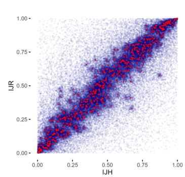{fig-alt="IJR versus IJH scatter plot showing concentrated dependence" width="100%"}

::: {.small}
:::
:::
:::

### Contributions

**Multiscale multivariate Bernstein copula prior**: we develop a multivariate extension of 
multiscale Bernstein copula 

**Adaptive sparsity**: we show how to use spike-and-slab shrinkage to yield sparse posterior trees

**Flexible copulas**: we propose nonparametric high-dimensional copula estimation in feasible time

**Posterior theory**: we prove weak posterior consistency.

**Empirical evidence**: we show remarkable simulation performance and a seven-dimensional portfolio-risk application.

## From one scale to many dimensions: tree representation {.bernstein-progression-slide}

::: {.bernstein-progression}
::: {.progression-card}
**1. Single-scale, univariate**

One fixed resolution $S$:

$$
f(y)=\sum_{h=1}^{2^S}\pi_h\,b_{S,h}(y).
$$

All basis functions share the same scale.

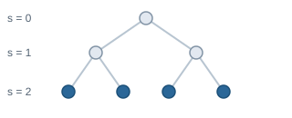{fig-alt="Tree with only the fixed terminal scale highlighted" width="100%"}

Components: $$2^S$$

:::

→

::: {.progression-card}
**2. Multiscale, univariate**

Mix across resolutions:

$$
f(y)=\sum_{s\ge0}\sum_{h=1}^{2^s}\pi_{s,h}\,b_{s,h}(y).
$$

Coarse and fine detail can coexist.

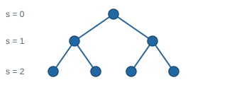{fig-alt="Univariate tree with basis nodes at multiple scales" width="100%"}

Components through scale $S$: $$2^{S+1}-1$$

:::

→

::: {.progression-card}
**3. Multiscale, multivariate**

Tensor products across $d$ coordinates:

$$
f(\mathbf y)=\sum_{s\ge0}\sum_{\mathbf h}
\pi_{s,\mathbf h}\prod_{j=1}^{d}b_{s,h_j}(y_j).
$$

Here $\mathbf h\in\{1,\ldots,2^s\}^d$.

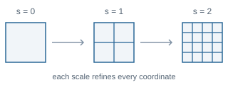{fig-alt="Two-dimensional multiscale partitions refined from one cell to sixteen" width="100%"}

Components through scale $S$: $$\dfrac{2^{d(S+1)}-1}{2^d-1}$$

:::
:::

::: {.progression-note}
**Bernstein-Kantorovich polynomial basis:** $b_{s,h}(y)=\operatorname{Be}(y;h,2^s-h+1)$, the univariate beta basis function.
:::

## Univariate multiscale Bernstein representation {.univariate-tree-slide}

::: {.columns .univariate-tree-layout}
::: {.column width="50%"}

For $y\in[0,1]$, multiscale Bernstein polynomial mixture

$$
f(y)=\sum_{s=0}^{\infty}\sum_{h=1}^{2^s}
\pi_{s,h}\,\operatorname{Be}(y;h,2^s-h+1).
$$

- $s$: **scale**, controlling resolution.
- $h$: **node** at scale $s$.
- $\pi_{s,h}$: probability weight for basis $\{s,h\}$.

At scale $s$, the tree has $2^s$ candidate nodes.

:::

::: {.column width="50%"}
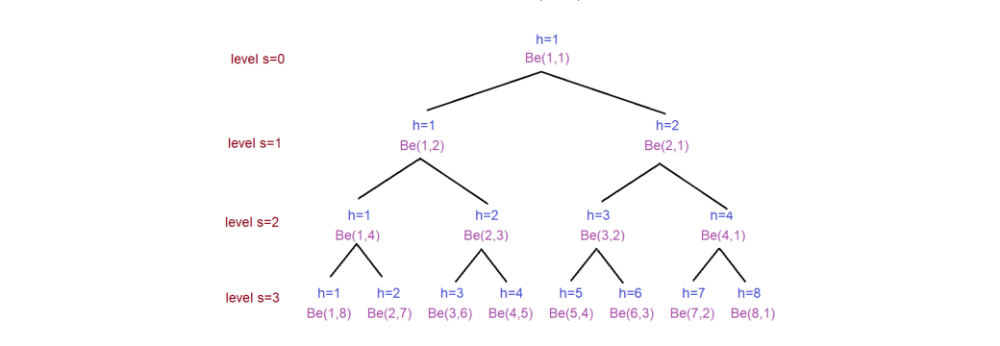{fig-alt="Binary multiscale Bernstein mixture tree from the paper" width="100%"}

Each node contributes a beta density, weighted by its stopping probability and path probability.

:::
:::

## Tree prior and posterior updating {.tree-prior-posterior-slide}

::: {.columns .tree-update-columns}
::: {.column}
### Prior at each node

At node $(s,h)$, the stopping and right-branch probabilities have priors

$$
\underbrace{S_{s,h}\sim\operatorname{Be}(1,a)}_{\text{probability of stopping}},\qquad
\underbrace{R_{s,h}\sim\operatorname{Be}(b,b)}_{\text{probability of taking the right branch}}
$$

The resulting node weight is

$$
\pi_{s,h}=S_{s,h}\prod_{r<s}(1-S_{r,g_{s,h,r}})T_{s,h,r}.
$$

At ancestor node $g_{s,h,r}$, the branch probability is

$$
T_{s,h,r}=
\begin{cases}
R_{r,g_{s,h,r}},&\text{right branch},\\
1-R_{r,g_{s,h,r}},&\text{left branch}.
\end{cases}
$$

Truncate $\infty$ at $s_{\max}$ and set terminal stopping probabilities to one.
:::

::: {.column}
### Posterior given node allocations

Beta-binomial conjugacy gives

$$
\begin{aligned}
S_{s,h}\mid y&\sim\operatorname{Be}(1+n_{s,h},a+v_{s,h}-n_{s,h}),\\
R_{s,h}\mid y&\sim\operatorname{Be}(b+r_{s,h},b+v_{s,h}-n_{s,h}-r_{s,h}).
\end{aligned}
$$

- $n_{s,h}$: observations allocated to the node.
- $v_{s,h}$: observations passing through it.
- $r_{s,h}$: observations proceeding to its right daughter.
:::
:::

## Adaptive posterior sparsity {.adaptive-sparsity-slide}

::: {.columns .adaptive-sparsity-columns}
::: {.column }
### Spike-and-slab prior

Introduce an inclusion indicator and let it control $S_{s,h}$:

$$
\begin{aligned}
\gamma&\sim\operatorname{Bernoulli}(\psi),\\
\kappa\mid\gamma=0&\sim\delta_0,\qquad
\kappa\mid\gamma=1\sim p(\kappa).
\end{aligned}
$$

Marginally, $\kappa\sim\psi p(\kappa)+(1-\psi)\delta_0$, with $S_{s,h}\sim\operatorname{Be}(\kappa,a)$. 

A small $\psi$ leads to near-zero stopping probabilities for unsupported nodes.

### Posterior sparsity

Given node allocations, the stopping update is

$$
S_{s,h}\mid y\sim
\operatorname{Be}(\kappa+n_{s,h},\ a+v_{s,h}-n_{s,h}).
$$

**Active:** the nodes contain observations -- red segments.

**Dormant:**  empty cells; their weights are omitted.

:::

::: {.column }
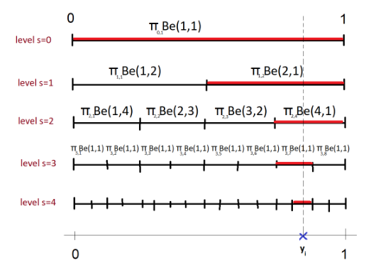{fig-alt="One-dimensional sparse Bernstein tree with active paths highlighted" width="80%"}

Only paths intersecting observations need to be retained.

:::
:::

## The multivariate extension {.multivariate-construction-slide}

::: {.columns .multivariate-construction-columns}
::: {.column }

For $y=(y_1,\ldots,y_d)\in[0,1]^d$:

$$
f(y)=\sum_{s=0}^{\infty}\ \sum_{\mathbf h\in\{1,\ldots,2^s\}^d}
\pi_{s,\mathbf h}\prod_{j=1}^{d}
\operatorname{Be}(y_j;h_j,2^s-h_j+1)
$$

The multivariate node weight is different from before:

In one dimension, a single $R_{s, h}\sim\operatorname{Be}(b,b)$ gives the two daughter shares $(R_{s, h},1-R_{s, h})$. 

In $d$ dimensions, each node has $2^d$ daughters, so:

$$
\begin{aligned}
\mathbf Q_{s,\mathbf h}&\sim\operatorname{Dir}(\boldsymbol b),\qquad
\boldsymbol b =(b_1,\ldots,b_{2^d})%,%\qquad
%\sum_{k=1}^{2^d}Q_{s,\mathbf h,k}=1.
\end{aligned}
$$

give  the joint probabilities of advancing to any one of the $2^d$ daughter nodes of the node $(s,h)$.

With stopping probability $S_{s,\mathbf h}\sim\operatorname{Be}(\kappa,a)$, the weights are

$$
\begin{aligned}
\pi_{s,\mathbf h}
&=S_{s,\mathbf h}
\prod_{r=0}^{s-1}\left(1-S_{r,\mathbf g_{s,\mathbf h,r}}\right)
Q_{r,\mathbf g_{s,\mathbf h,r}},
\end{aligned}
$$

where $\mathbf g_{s,\mathbf h,r}$ is the level-$r$ ancestor of $\mathbf h$. 

:::

::: {.column }

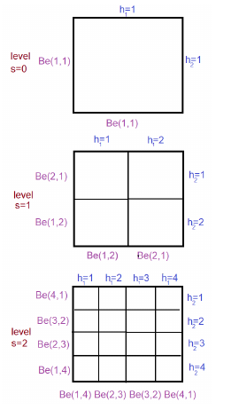{fig-alt="Two-dimensional Bernstein mixture tree" height="460"}

Each node contributes a tensor-product of beta densities, weighted by its stopping probability and path probability.

:::
:::

## Multivariate posterior sparsity {.multivariate-sparsity-slide}

::: {.columns .sparse-computation-columns}
::: {.column}

For each node $(s,\mathbf h)$, the multivariate stopping distribution is $S_{s,\mathbf h}\sim\operatorname{Be}(\kappa,a),$ 
with spike-and-slab prior for $\kappa$ as before. 

Given node allocations, the posterior becomes

$$
S_{s,\mathbf h}\mid y
\sim\operatorname{Be}(\kappa+n_{s,\mathbf h},
a+v_{s,\mathbf h}-n_{s,\mathbf h}),
$$
$$
\mathbf Q_{s,\mathbf H}\mid y
\sim\operatorname{Dir}(\mathbf b+\mathbf q_{s,\mathbf H}),
$$

where $n_{s,\mathbf h} =$ number of observations allocated to the node, $v_{s,\mathbf h}=$ number passing through it, $\mathbf q_{s,\mathbf H} =$ number proceeding to each daughter.

Dirichlet-multinomial conjugacy $\Rightarrow$ updates to branch allocations jointly across all $2^d$ daughters.

- **Active node:** at least one observation lies in the node's grid cell; otherwise it is **dormant**.

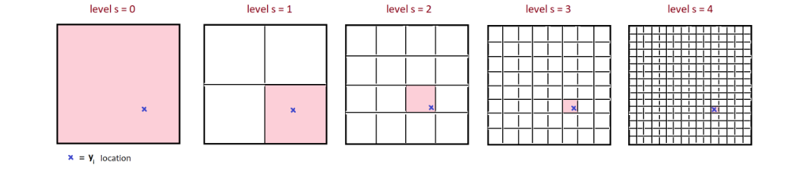{fig-alt="Active and dormant grid cells in two dimensions" width="100%"}

At increasing resolution, most cells contain no observed points.

:::
:::

## What the sparse tree looks like {.sparse-tree-gap-slide}
For maximum scale $S_{\max}$, the full tree has

$$
N_{\mathrm{full}}=\sum_{s=0}^{S_{\max}}2^{ds}
=\frac{2^{d(S_{\max}+1)}-1}{2^d-1}.
$$

::: {.columns .sparse-tree-gap-columns}
::: {.column}
### Adaptive sparsity example ($d=3$)

| Maximum scale | Full nodes | Sparse nodes |
|---:|---:|---:|
| 6 | 299,593 | 212 |
| 8 | 19,173,961 | 412 |
| 9 | 153,391,689 | 512 |
| 10 | **1,227,133,513** | **612** |

:::

::: {.column}
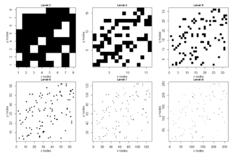{fig-alt="Occupied cells at varying multiscale levels" width="100%"}

Occupied cells become a small fraction of all possible cells as resolution increases.

:::
:::

## Flexible dependence and flexible marginals {.marginal-slide}

Write $u_j=F_j(x_j)$ and define a joint density via ${f_X(x_1,\ldots,x_d)=c(u_1,\ldots,u_d)\prod_{j=1}^d f_j(x_j)}$.

- The sparse multiscale Bernstein mixture supplies the **dependence kernel** $c$.
- Nonparametric marginal models transform the observations to $[0,1]^d$.
- We use dynamic Dirichlet-process mixture for the marginals in financial application.

$$
\begin{aligned}
x_t &= \gamma + h_t^{1/2}\varepsilon_t,\\
h_t &= \omega+\alpha x_{t-1}+\beta h_{t-1},\\
\varepsilon_t\mid\lambda_t &\sim N(0,\lambda_t^{-1}),\\
\lambda_t\mid G&\sim G,\qquad G\sim\operatorname{DP}(\nu,G_0).
\end{aligned}
$$

The marginal CDFs map real-valued returns into the unit hypercube for joint dependence modeling.

## Seven-dimensional ETF portfolio {.portfolio-slide}

| Asset | Ticker | Weight |
|:--|:--|--:|
| S&P 500 equity | IVV | 34.5% |
| Total USD bond market | IUSB | 33.1% |
| International developed equity | IDEV | 17.0% |
| Emerging-market equity | IEMG | 6.0% |
| International aggregate bonds | IAGG | 5.8% |
| US mid-cap equity | IJH | 2.0% |
| US small-cap equity | IJR | 0.9% |

- Daily log returns, **3 January 2022 to 31 May 2024**; $T=606$.
- A **seven-dimensional** sparse copula for cross-asset dependence.
- Forecasting over **1 June 2023 to 31 May 2024**.
- Per trading day: **100 burn-in iterations**, followed by **1,000 posterior iterations**.

## Estimated dependence: mid-cap versus small-cap {.dependence-slide}

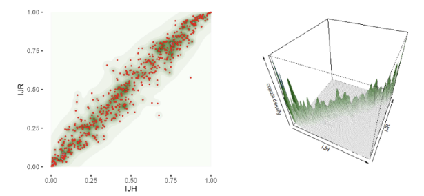{fig-alt="Estimated copula density for IJH and IJR from the paper" height="490"}

Estimated bivariate slice of the seven-dimensional dependence model.

## VaR and Expected Shortfall forecasts {.var-es-slide}

::: {.columns .var-es-columns}
::: {.column}
For predictive portfolio return $R_{t+1}$:

$$
\operatorname{VaR}_{\alpha,t+1}= -Q_{\alpha}(R_{t+1}\mid\mathcal F_t),
$$

$$
\operatorname{ES}_{\alpha,t+1}= -\mathbb E[R_{t+1}\mid R_{t+1}\le Q_\alpha,\mathcal F_t].
$$

Posterior predictive simulations for quantile and tail average. 
:::

::: {.column}
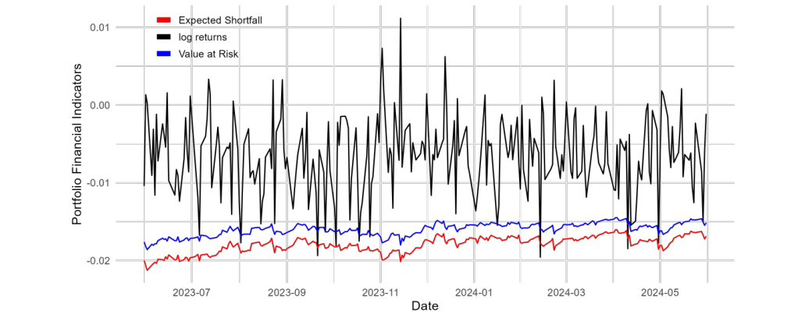{fig-alt="Time series of predicted VaR and Expected Shortfall" width="100%"}

The full run took about one hour on a Dell Precision T7960 workstation.

:::
:::

## Main takeaways {.conclusions-slide}

::: {.columns .conclusions-qr-columns}
::: {.column}
- **Adaptive multiscale resolution** captures locally concentrated dependence.
- **Spike-and-slab shrinkage** removes computationally negligible tree branches.
- **Massive reductions** in active tree size make multivariate estimation feasible.
- **Seven-dimensional risk forecasting** illustrates practical usefulness.
- See paper for: 
    - **Weak posterior consistency** under general conditions.
    - **Simulations** supporting accuracy across copula families.
:::

::: {.column}
{fig-alt="QR code linking to the paper DOI https://doi.org/10.1080/10618600.2026.2648594" width="190"}

::: {.small}
Scan for the paper  
:::
:::
:::

